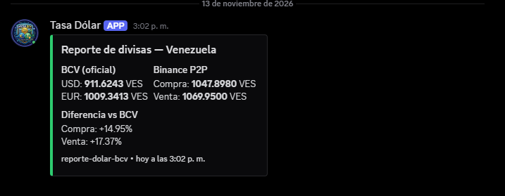
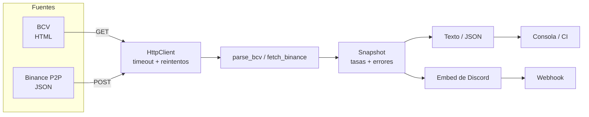

# reporte-dolar-bcv

[](https://github.com/GarWox/reporte-dolar-bcv/actions/workflows/ci.yml)

Monitor de la tasa oficial del Banco Central de Venezuela (USD y EUR) y del mercado P2P de Binance (USDT/VES). Calcula la brecha cambiaria, imprime el reporte en consola o JSON y puede publicarlo automáticamente en Discord cuatro veces al día (00, 07, 14 y 21 UTC).

```
Reporte de divisas — 2026-11-13 14:30 UTC

BCV (oficial)
  USD  36.5872 VES
  EUR  42.1056 VES

Binance P2P (USDT/VES)
  Compra  40.2500 VES
  Venta   40.9000 VES

Diferencia vs BCV
  Compra  +10.01%
  Venta   +11.79%
```

## Demo

Reporte real publicado en el canal de Discord por el workflow programado:



También puedes ver el historial de ejecuciones en [GitHub Actions](https://github.com/GarWox/reporte-dolar-bcv/actions/workflows/monitor.yml).

## Qué resuelve

Consultar el dólar a mano todos los días es repetitivo y propenso a errores de formato (`36,5872` vs `36.5872`). Este proyecto automatiza la recolección, normaliza los números, valida que las tasas sean coherentes y deja el resultado en un formato consumible por personas (`texto`), por otros programas (`--json`) y por un canal de alertas (Discord).

Si una fuente falla, el reporte no se pierde: se publica lo que sí respondió y se advierte qué faltó.

## Arquitectura



El flujo es una sola pasada: fuentes → normalización → `Snapshot` inmutable → renderizado. Las fuentes y los notificadores no se conocen entre sí, así que se pueden probar y reemplazar por separado.

## Stack

- Python 3.10+ con type hints y `dataclasses`
- `requests` con `Retry` y timeouts explícitos
- `BeautifulSoup` para el HTML del BCV
- `python-dotenv` para configuración
- `pytest` + `responses` para tests sin red
- `ruff` para lint
- GitHub Actions para CI y ejecución programada
- Docker para ejecución reproducible

## Instalación

```bash
git clone https://github.com/GarWox/reporte-dolar-bcv.git
cd reporte-dolar-bcv
python -m venv .venv
source .venv/bin/activate        # Windows: .venv\Scripts\activate
pip install -e ".[dev]"
cp .env.example .env
```

## Uso

```bash
python -m dolar_monitor                 # reporte legible
python -m dolar_monitor --json          # salida para pipelines
python -m dolar_monitor --discord       # publica en Discord
python -m dolar_monitor --discord --dry-run   # muestra el payload sin enviarlo
```

También queda disponible el comando `dolar-monitor` tras instalar el paquete.

### Ejemplo de salida JSON

```json
{
  "fetched_at": "2026-11-13T14:30:00+00:00",
  "bcv": { "usd": 36.5872, "eur": 42.1056 },
  "binance": { "buy": 40.25, "sell": 40.9 },
  "spread_pct": { "buy": 10.01, "sell": 11.79 },
  "errors": []
}
```

`binance.buy` es el precio al que **compras** USDT pagando VES; `binance.sell` es el precio al que **vendes** USDT. La brecha se calcula contra el dólar oficial del BCV.

### Códigos de salida

| Código | Significado                                |
| ------ | ------------------------------------------ |
| 0      | Reporte generado (aunque falte una fuente) |
| 1      | Ninguna fuente respondió                   |
| 2      | Se pidió Discord sin `DISCORD_WEBHOOK_URL` |
| 3      | Falló el envío a Discord                   |

## Configuración

| Variable              | Default                   | Descripción                                             |
| --------------------- | ------------------------- | ------------------------------------------------------- |
| `DISCORD_WEBHOOK_URL` | vacío                     | Webhook de Discord. Sin él, solo se imprime en consola. |
| `HTTP_TIMEOUT`        | `15`                      | Timeout de red en segundos.                             |
| `LOG_LEVEL`           | `INFO`                    | `DEBUG`, `INFO`, `WARNING` o `ERROR`.                   |
| `BCV_URL`             | `https://www.bcv.org.ve/` | Permite apuntar a un fixture o proxy.                   |
| `BINANCE_URL`         | endpoint P2P              | Permite apuntar a un mock.                              |

## Docker

```bash
docker compose run --rm monitor
```

El contenedor ejecuta el mismo entrypoint y toma las variables desde `.env`.

## Tests y calidad

```bash
pytest
ruff check .
```

La suite cubre:

- parseo de números venezolanos (`1.234,56` y `36,5872`);
- extracción de tasas del HTML del BCV, incluidos los ids alternativos;
- respuestas vacías, no JSON y anuncios incompletos de Binance;
- fallo parcial: se conserva la fuente que sí respondió;
- cálculo de brechas y división por cero;
- renderizado de texto, JSON y embed;
- payload y errores del webhook de Discord;
- códigos de salida de la CLI.

Los tests no tocan la red: `responses` intercepta HTTP y los fixtures viven en `tests/fixtures/`.

## Decisiones de diseño

- **TLS del BCV.** El certificado del BCV ha presentado problemas. Primero se intenta con verificación TLS; solo si falla con `SSLError` se reintenta sin verificar, dejando un warning en el log. No se desactiva la verificación de forma silenciosa ni por defecto.
- **Fallos parciales.** Un `Snapshot` puede tener BCV, Binance, ambos o ninguno. La CLI devuelve 0 mientras exista al menos una tasa, para no romper la ejecución programada por una fuente caída.
- **Reintentos.** Se reintentan 429, 500, 502, 503 y 504 con backoff, pero los errores de validación no: un precio en cero no se arregla reintentando.
- **Sin ORM ni base de datos.** El caso de uso es una foto del presente. Persistir histórico sería otro proyecto (ver roadmap).
- **Salida JSON.** Convierte el script en una pieza de pipeline que puede consumir un dashboard o un bot sin acoplarse al formato de consola.
- **Fuentes desacopladas.** `fetch_bcv` y `fetch_binance` reciben un cliente HTTP y una URL, lo que permite testear con `responses` y apuntar a mocks.

## Estructura

```
src/dolar_monitor/
├── cli.py            # argumentos, orquestación y códigos de salida
├── config.py         # Settings desde variables de entorno
├── errors.py         # SourceError, NotificationError
├── http.py           # sesión con retries, timeout y fallback TLS
├── models.py         # BcvRates, BinanceRates, Snapshot, spread_pct
├── parsing.py        # números en formato venezolano
├── report.py         # texto, JSON y embed de Discord
├── service.py        # composición de fuentes y fallos parciales
├── sources/          # bcv.py, binance.py
└── notifiers/        # discord.py
tests/                # pytest + responses + fixtures
```

## Aviso

Los datos pertenecen al BCV y a Binance. El scraping del BCV puede romperse si cambia el HTML; por eso el parseo está aislado y cubierto por tests. Este proyecto no ofrece asesoría financiera.
